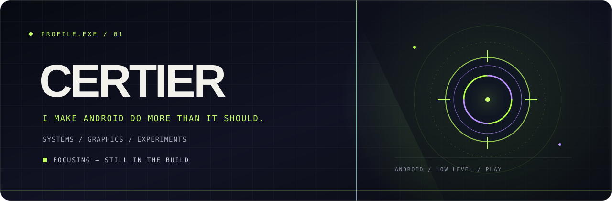

  

  <strong>Hey, I’m certier.</strong>

  I get curious about how things work, then keep poking until they do something unexpected. 
  Lately that curiosity lives around Android, graphics, and systems code. 
  Still learning, still experimenting, and usually one question away from a new rabbit hole.

  
  
  
  

  <code>🎯 CURRENTLY FOCUSING</code> &nbsp; · &nbsp; <code>HAPPY TO EXPERIMENT</code>

